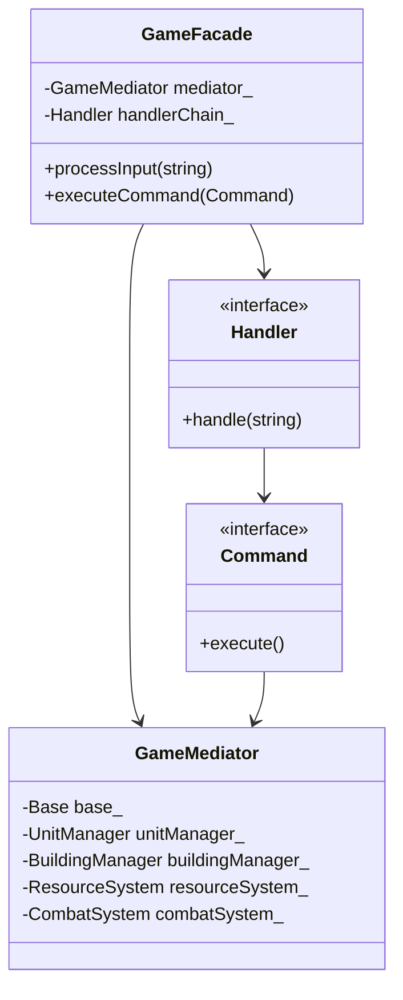

# MMORPG

Лабораторная работа по ООП

**Язык:** C++14. **Сборка:** Visual Studio 2022

# MMORPG: Lab 3 (Facade, Mediator, Command, Chain of Responsibility)

## Архитектура и UML

Система построена на четырех ключевых паттернах:
1. **Фасад (Facade)** — `GameFacade` предоставляет единый интерфейс для пользователя, скрывая сложность подсистем.
2. **Посредник (Mediator)** — `GameMediator` координирует взаимодействие между `Base`, `UnitManager`, `BuildingManager`, `ResourceSystem` и `CombatSystem`.
3. **Команда (Command)** — Все действия пользователя оформлены как классы, наследующие `Command` (например, `CreateUnitCommand`, `MoveUnitCommand`).
4. **Цепочка обязанностей (Chain of Responsibility)** — Обработка текстового ввода идет по цепочке хендлеров (`CreateHandler` -> `MoveHandler` -> ... -> `StatsHandler`).

## Предметная область

*   **Base** — управляет юнитами, ресурсами и зданиями. Реализует `IObserver` для отслеживания смерти юнитов.
*   **Unit** — базовый класс юнитов (`Infantry`, `Scout`, `Tank`, `Worker`, `Medic`).
*   **Building** — базовый класс зданий (`Barracks`, `PowerPlant`, `Laboratory`, `Warehouse`, `Hospital`).
*   **UnitManager** — хранит всех юнитов, умеет перемещать и удалять.
*   **BuildingManager** — управляет постройкой зданий и производством.
*   **ResourceSystem** — управляет запасами (дерево, металл, энергия).
*   **CombatSystem** — рассчитывает урон с учетом атаки и брони.

## Команды (примеры)

*   `create unit <type> at <x>,<y>`
*   `move unit <id> to <x>,<y>`
*   `attack unit <id> target <id>`
*   `collect unit <id> from <resourceId>`
*   `build <type> at <x>,<y>`
*   `research <techId>`
*   `distribute <resource> to <target> <amount>`
*   `produce <type> in <buildingId>`
*   `stats`
*   `map`

## Сценарии

В `main.cpp` реализованы 4 сценария:

1. **Создание и статистика** — спавн юнитов, вывод `stats`.
2. **Перемещение и атака** — `move unit 1 to 10,10`, `attack unit 1 target 2`.
3. **Постройка и исследование** — `build barracks at 20,15`, `research attack_upgrade`, `produce infantry in 1`.
4. **Сбор и распределение ресурсов** — `collect unit 3 from 1`, `distribute wood to barracks 50`.