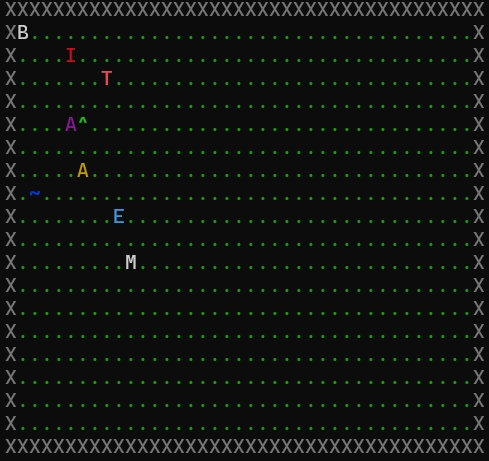

# MMORPG

[](https://github.com/aqcbb/mmorpg/releases)
[]()

Лабораторная работа по ООП

**Язык:** C++14. **Сборка:** Visual Studio 2022

## Демонстрация

Поле с базой, юнитами, ландшафтами и нейтральными объектами:



## Структура проекта
```
include/
├── attributes/ # Health, Armor, Attack
├── base/ # Base (учет юнитов, Observer)
├── controller/ # GameController (интеграция)
├── core/ # UnitType, UnitTypeInfo, Point, Colors
├── factories/ # UnitFactory, ConcreteUnitFactory
├── field/ # GameField, GameFieldIterator
├── neutral/ # NeutralObject, IInteractionStrategy + объекты и стратегии
├── observer/ # IObserver, IObservable, UnitEvent
├── terrain/ # Terrain, TerrainProxy, TerrainMap + типы ландшафта
└── units/ # Unit + Infantry, Archer, Mage, FlyingUnit
src/
├── base/
├── controller/
├── core/
├── factories/
├── field/
├── neutral/
├── terrain/
└── main.cpp # Демонстрационные сценарии
```

## Юниты
```
Unit (абстрактный)
├── Infantry (Пехота)
├── Archer (Лучник)
├── Mage (Маг)
└── FlyingUnit (Летающий)
```

Базовый `Unit` хранит атрибуты (`Health`, `Armor`, `Attack`), координаты, `id`, символ для отрисовки и ссылку на `UnitTypeInfo`. Наследуется от `IObservable` для рассылки событий.

## Атрибуты

- **Health** — `decrease`, `increase`, `isZero`; HP не уходит ниже 0.
- **Armor** — `reduceDamage(damage)` уменьшает урон на величину брони.
- **Attack** — `getDamage()`, `calculateDamage(const Armor&)`.

## Паттерн: Наблюдатель (Observer)

`Base` реализует `IObserver` и подписывается на события юнитов (`UnitEvent`).
Юнит наследует `IObservable` и при получении урона или смерти вызывает `notify()`.
База получает уведомление `Destroyed` и освобождает лимит юнитов (`maxUnits`).

## Паттерн: Прокси (Proxy)

`TerrainProxy` наследует `Terrain` и оборачивает реальный ландшафт (`Plains`, `Forest`, `Swamp`, `Mountains`).
Он перехватывает запросы `isPassable`, `getSpeedModifier`, `getDefenseBonus`.
Главная особенность — летающие юниты (`FlyingUnit`) проходят любые горы и не замедляются болотом, игнорируя ограничения реального ландшафта.

## Паттерн: Стратегия (Strategy)

`IInteractionStrategy` инкапсулирует алгоритмы влияния на юнитов.
`NeutralObject` хранит стратегию и делегирует ей работу.

- `TreasureChest` → `ResourceStrategy` (сбор ресурсов).
- `Trap` → `DamageStrategy` (нанесение урона).
- `EnergySource` → `HealthRestoreStrategy` (восстановление HP).
- `Altar` → динамически выбирает `AttackBoostStrategy` (для пехоты/лучников) или `ManaBoostStrategy` (для магов).

## Перегрузка операторов

Взаимодействие реализовано как свободные операторы:
- `unit + chest` — юнит собирает ресурсы.
- `unit - trap` — юнит получает урон.
- `unit * altar` — юнит получает временный бафф.
- `unit / source` — юнит восстанавливает здоровье.

## GameField и TerrainMap

- `GameField` — прямоугольная сетка (`std::vector<std::vector<std::shared_ptr<Unit>>>`), хранит юнитов, отрисовывает их, поддерживает итератор по занятым клеткам.
- `TerrainMap` — матрица ландшафтов (`std::vector<std::vector<std::shared_ptr<TerrainProxy>>>`), отвечает за свойства клеток.
- `Base` — физически занимает клетку на карте (отрисовывается символом `B`), создаёт юнитов через фабрику, ведёт их учёт и реагирует на смерть.

## Итератор

`GameField::Iterator` обходит **только занятые клетки**, пропуская рамку и пустые. Поддерживает `*`, `++`, `!=`.

```cpp
for (auto it = field.begin(); it != field.end(); ++it) {
    (*it)->takeDamage(50);
}```

## Правило пяти

Реализованы все 5 методов `GameField`: деструктор, copy ctor, copy assign, move ctor, move assign. Копирование — глубокое, через `clone()` каждого юнита (при переходе на `shared_ptr` move-операции используют `= default`).

## Сценарии

- `runCreationAndMovementScenario` — создание базы, спавн юнитов через фабрику, отрисовка карты.
- `runTerrainProxyScenario` — проверка `Proxy`: пехота не проходит горы, летающий юнит пролетает.
- `runNeutralObjectsScenario` — взаимодействие с объектами через операторы (ловушка бьёт мага).
- `runObserverDeathScenario` — уничтожение юнита и уведомление базы через `Observer`.