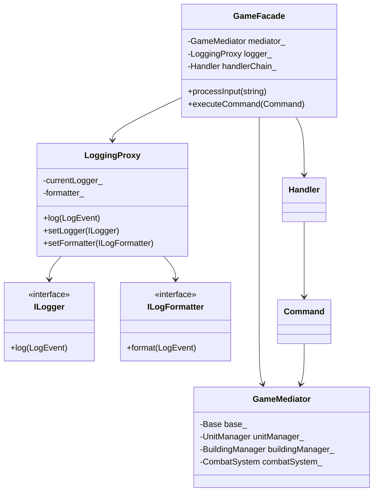

# MMORPG

Лабораторная работа по ООП

**Язык:** C++14. **Сборка:** Visual Studio 2022

## Архитектура и UML

Система построена на ключевых паттернах проектирования:
1. **Фасад (Facade)** — `GameFacade` предоставляет единый интерфейс для пользователя.
2. **Посредник (Mediator)** — `GameMediator` координирует взаимодействие между `Base`, `UnitManager`, `BuildingManager` и `CombatSystem`.
3. **Команда (Command)** — Действия пользователя оформлены как классы (например, `CreateUnitCommand`, `MoveUnitCommand`).
4. **Цепочка обязанностей (Chain of Responsibility)** — Обработка текстового ввода идет по цепочке хендлеров (`CreateHandler` -> `MoveHandler` -> ... -> `StatsHandler`).
5. **Адаптер (Adapter)** — `ILogFormatter` и его реализации (`TextFormatter`, `JsonFormatter`, `CsvFormatter`) преобразуют события в нужный формат.
6. **Прокси (Proxy)** — `LoggingProxy` управляет текущим логгером и форматом, позволяя менять их на лету.
7. **RAII** — `FileLogger` открывает файл в конструкторе и закрывает в деструкторе.

## Предметная область

* **Base** — управляет юнитами, ресурсами и зданиями. Реализует `IObserver`.
* **Unit** — базовый класс юнитов (`Infantry`, `Scout`, `Tank`, `Worker`, `Medic`, `Archer`, `Mage`).
* **Building** — базовый класс зданий (`Barracks`, `PowerPlant`, `Laboratory`, `Warehouse`, `Hospital`).
* **Terrain** — ландшафт (`Plains`, `Forest`, `Swamp`, `Mountains`), влияющий на проходимость.
* **NeutralObject** — нейтральные объекты (`TreasureChest`, `Trap`, `Altar`, `EnergySource`).
* **UnitManager** — хранит всех юнитов, умеет перемещать и удалять.
* **BuildingManager** — управляет постройкой зданий и производством.
* **CombatSystem** — рассчитывает урон с учетом атаки и брони.

## Команды

* `create unit <type> at <x>,<y>` — создание юнита.
* `move unit <id> to <x>,<y>` — перемещение.
* `attack unit <id> target <id>` — атака.
* `collect unit <id> at <x>,<y>` — сбор ресурсов.
* `build <type> at <x>,<y>` — постройка здания.
* `produce <type> in <buildingId>` — производство юнита в здании.
* `spawn_object <type> at <x>,<y>` — создание нейтрального объекта.
* `stats` — статистика.
* `set_logger <console|file|null>` — смена логгера.
* `set_format <text|json|csv>` — смена формата.
* `map` — отрисовка карты.
* `exit` — выход.

## Демонстрационные сценарии (Логирование)

1. **Логирование в консоль (Text):**

2. **Логирование в файл (JSON):**

3. **Отключение логирования (Null):**

4. **Смена формата (CSV):**
