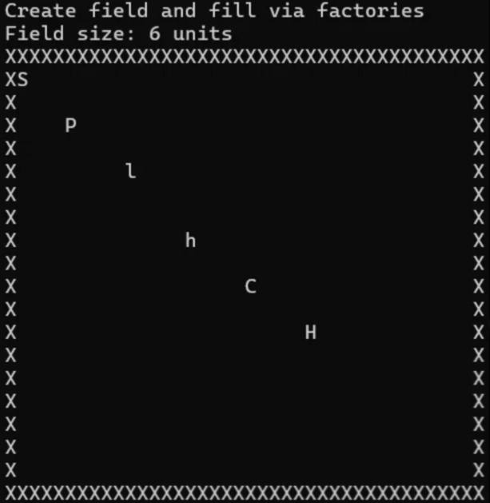

# MMORPG

Лабораторная работа по ООП: иерархия юнитов, паттерн «Фабричный метод», игровое поле с глубоким копированием, move-семантикой и собственным итератором.

**Язык:** C++14. **Сборка:** Visual Studio 2022

## Демонстрация

Поле 40×20 с шестью юнитами, созданными через фабрики:



## Структура проекта
```
include/
├── attributes/ # Health, Armor, Attack
├── units/ # Unit → Infantry / Archer / Cavalry → 6 конкретных юнитов
├── factories/ # UnitFactory + 6 конкретных фабрик
└── field/ # GameField, GameFieldIterator
src/
├── field/ # реализация GameField
└── main.cpp # 6 демонстрационных сценариев
```

## Юниты
```
Unit (абстрактный)
├── Infantry → Swordsman, Spearman
├── Archer → LightArcher, HeavyArcher
└── Cavalry → Cataphract, HorseArcher
```

Базовый `Unit` хранит атрибуты (`Health`, `Armor`, `Attack`), координаты и символ для отрисовки. Чисто виртуальные методы: `getType()`, `clone()`.

## Атрибуты

- **Health** — `decrease`, `increase`, `isZero`; HP не уходит ниже 0.
- **Armor** — `reduceDamage(damage)` уменьшает урон на величину брони.
- **Attack** — `getDamage()`, `calculateDamage(const Armor&)`.

## Паттерн: Factory Method

`UnitFactory` — абстрактный создатель с методом
`virtual std::unique_ptr<Unit> createUnit() const = 0;`.
Шесть конкретных фабрик: `SwordsmanFactory`, `SpearmanFactory`,
`LightArcherFactory`, `HeavyArcherFactory`, `CataphractFactory`,
`HorseArcherFactory`.

**Почему не Abstract Factory:** юниты независимы, семейств нет.

Паттерн даёт: инкапсуляцию создания, Open/Closed (новый юнит = новая фабрика), единую точку изменения параметров юнита.

## GameField

Прямоугольная сетка (`std::vector<std::vector<std::unique_ptr<Unit>>>`),
рамка по периметру, лимит `maxUnits`. Операции: `addUnit`, `removeUnit`,
`getUnit`, `size`, `empty`, `clear`, `draw`. Проверяются границы, занятость
клетки и лимит.

## Итератор

`GameField::Iterator` обходит **только занятые клетки**, пропуская рамку и пустые. Поддерживает `*`, `++`, `!=`.

```cpp
for (auto it = field.begin(); it != field.end(); ++it) {
    (*it)->takeDamage(50);
}
```

## Правило пяти

Реализованы все 5 методов `GameField`: деструктор, copy ctor, copy assign,
move ctor, move assign. Копирование — глубокое, через `clone()` каждого юнита.

## Сценарии

- `runCreateFieldScenario` — создание поля 40×20, наполнение через фабрики.
- `runDeepCopyScenario` — глубокое копирование, проверка независимости.
- `runMoveScenario` — move-конструктор и move-присваивание.
- `runMassDamageScenario` — обход итератором + массовое действие.
- `runRemoveDuringIterationScenario` — безопасное удаление во время итерации.
- `runRuleOfFiveScenario` — проверка правила пяти.